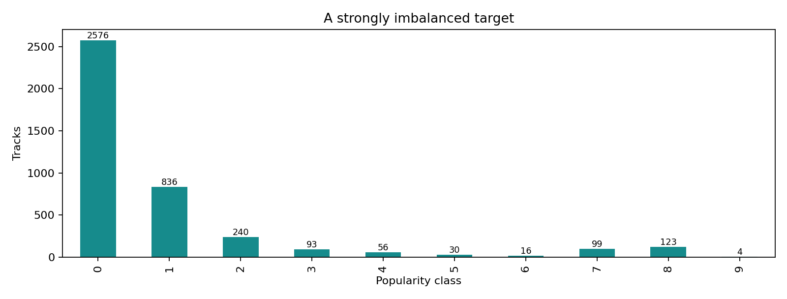
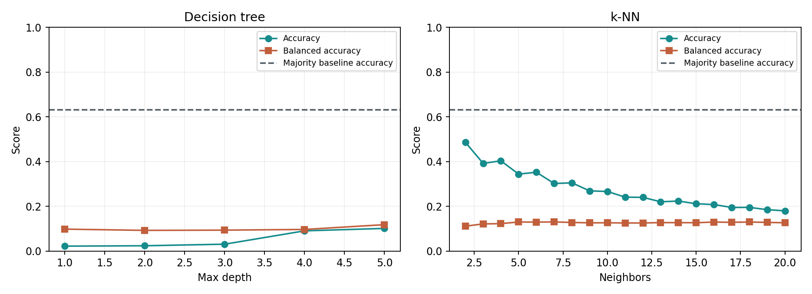
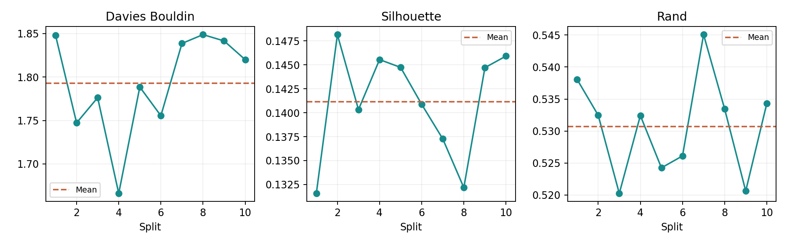

# Spotify Popularity Lab

**Can audio features distinguish low popularity levels?**

A reproducible Python project exploring **4,073 Spotify tracks**, severe class imbalance, supervised classification and k-means clustering. The project connects exploratory analysis with careful evaluation: a model can recognize some rare classes while still losing to a majority-class baseline on overall accuracy.

[Présentation en français](README.fr.md) · [Methodology](docs/methodology.md) · [Dataset instructions](data/README.md) · [CV description](docs/cv-fr.md)



## Main findings

The target contains ten observed labels (0–9). Class 0 accounts for **63.25%** of the source data; class 9 has only **four original tracks**.

| Model | Mean CV accuracy | Mean CV balanced accuracy | Mean CV macro-F1 |
|---|---:|---:|---:|
| Majority-class baseline | 63.24% | 10.00% | 0.077 |
| Depth-5 tree, 13 features | 10.45% | 11.77% | 0.035 |
| k-NN, 2 neighbors, training-only feature selection | 48.68% | 11.17% | 0.112 |

The 2-neighbor k-NN is the strongest tree/k-NN candidate **by CV accuracy** in this search. It does **not** beat the majority baseline on accuracy. On the held-out 30% test split, it reaches **51.15% accuracy**, **11.92% balanced accuracy** and **0.120 macro-F1**; the same test baseline obtains **63.26% accuracy**.

The small improvement on class-balanced metrics does not establish a useful popularity predictor. Only one class-9 song is present in the held-out test, and random artist overlap is possible. See [methodology and limits](docs/methodology.md).



## What the project does

- Audits data types, missing values, duplicates, outliers and label counts.
- Separates descriptors from the target and excludes track names, artist names and IDs.
- Fits scaling on training rows only and oversamples training classes without duplicating validation/test data.
- Compares tree depths 1–5 and k-NN with 2–20 neighbors on shared CV splits.
- Repeats feature selection within each training fold to avoid validation leakage.
- Reports accuracy, balanced accuracy, macro-F1, confusion counts and fit time.
- Runs k-means over ten different 70/30 splits and compares geometry with popularity agreement.
- Writes tables, figures and a run manifest containing the dataset checksum and software versions.

## Quick start

Use **Python 3.12** for the reference environment.

```bash
git clone https://github.com/IDIR2626/Classification-supervis-e-et-non-supervis-e-jeu-de-donn-es-musicales-.git
cd Classification-supervis-e-et-non-supervis-e-jeu-de-donn-es-musicales-
python -m venv .venv
```

Activate the environment:

```bash
# Linux / macOS
source .venv/bin/activate

# Windows PowerShell
.venv\Scripts\Activate.ps1
```

Install dependencies and the local package:

```bash
python -m pip install -r requirements.txt
python -m pip install --no-deps -e .
```

Download the source dataset following [data/README.md](data/README.md) and place the CSV at `data/raw/unpopular_songs.csv`. The raw file is not redistributed in this repository.

```bash
spotify-analysis --data data/raw/unpopular_songs.csv --output reports
```

The default seed is 42 and the default number of clustering repetitions is 10. To write a separate run without replacing the checked-in results:

```bash
spotify-analysis --data data/raw/unpopular_songs.csv --output reports-local --seed 42 --repeats 10
```

## Clustering results

K-means uses the original rows and all 13 descriptors, without the popularity target or class resampling. Centers are learned on the training partition and test rows are assigned to those learned centers.

| Test metric over 10 splits | Mean | Range |
|---|---:|---:|
| Davies–Bouldin, lower is better | 1.793 | 1.666–1.849 |
| Silhouette, higher is better | 0.141 | 0.132–0.148 |
| Unadjusted Rand | 0.531 | 0.520–0.545 |

The clusters are weakly separated on average. Rand measures agreement on pairs of tracks, including pairs separated by both partitions; **0.531 is not 53.1% popularity prediction accuracy**. Ten clusters do not automatically represent ten popularity levels.



## Project structure

```text
src/spotify_analysis/
    data.py             Dataset loading, schema checks and source checksum
    preprocessing.py    Training-only scaling and random oversampling
    experiments.py      Classification, held-out evaluation and clustering
    plots.py            Figures generated from the actual results
    cli.py              Reproducible command-line run
reports/
    figures/            README figures and the descriptive full tree
    tables/             Per-fold scores, summaries and confusion counts
    holdout_metrics.json
    run_metadata.json
tests/                  Synthetic-data tests; no source CSV required
docs/                   Methodology, limits and a French CV description
data/README.md          Source attribution and local data setup
```

## Tests and automation

```bash
python -m unittest discover -s tests -v
spotify-analysis --help
```

Eight local tests cover training-only scaling, preservation of categorical codes and indices, target/ID exclusion, missing-input errors, alignment checks, reproducible resampling and retention of the original observations. A GitHub Actions workflow is configured to run the tests and CLI help on pushes and pull requests. Local tests have been run; remote workflow status is established only after publication.

## Limits and next experiments

- The data concerns low-popularity tracks, not the entire Spotify catalogue or future hits.
- Random oversampling increases class weight but does not create new songs. Repeated songs can occupy multiple neighbor positions.
- Random splits may share artists; an artist-grouped split is a next validation experiment.
- `key` is retained as a numeric category code. One-hot/circular encoding should be tested as a sensitivity analysis.
- Zero tempos and unusually long durations are retained and documented.
- Ordinal regression, class-weighted trees and a no-resampling comparison are future experiments, not results claimed here.

## Data, author and license

Dataset: **Etienne GCC, Spotify Unpopular Songs**, [Kaggle source](https://www.kaggle.com/datasets/estienneggx/spotify-unpopular-songs/data). The checked-in manifest identifies the exact CSV used. No connection to the Spotify API or audio download is required.

Author: **Mohand Ouidir HOCINE** — [IDIR2626](https://github.com/IDIR2626).

Project code and documentation: [MIT license](LICENSE). The external dataset is not covered by this code license.
